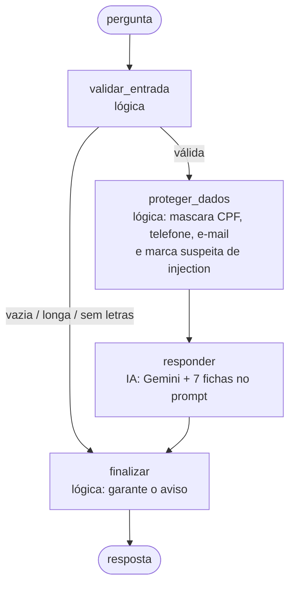

# Citizen Assist AI — Assistente Digital de Orientação ao Cidadão

**Global Solution — Prompt and Artificial Intelligence (FIAP, 2º semestre)**

**Integrantes:**
- Gabriel de Oliveira Souza — RM 571583
- Rafael Sá — RM 569223
- João Melo — RM 571116

## O que é

Um assistente que tira dúvidas sobre documentos pessoais (RG, CPF, título de eleitor, carteira de trabalho, certidões e CNH) usando **só** as 7 fichas da Central do Cidadão de Aurora (fictícia) fornecidas no desafio. Ele cita a ficha de onde tirou cada resposta, avisa que não é um canal oficial, não aceita dados pessoais e resiste a tentativas de prompt injection.

O projeto também tem um **LLM as a Judge** que avalia o assistente nas 26 mensagens do golden dataset, antes e depois de uma melhoria, e um roteiro de testes com usuários.

## Tecnologias

- Python, LangGraph e LangChain
- Gemini (`gemini-3.1-flash-lite`) via Google AI Studio
- pandas
- Google Colab

## Arquitetura

Um agente só, montado como um grafo de 4 nós. Só o nó `responder` usa IA; os outros são lógica comum.

## Como rodar

1. Clique no botão **Abrir no Colab** acima.
2. Gere uma chave em [aistudio.google.com/apikey](https://aistudio.google.com/apikey).
3. No Colab, clique no ícone de chave 🔑 (Secrets), crie um secret chamado `KEY-GS` com a chave e ligue **Acesso ao notebook**.
4. **Ambiente de execução → Executar tudo.** As fichas são baixadas deste repositório automaticamente. A avaliação (seções 8 e 10) faz cerca de 100 chamadas ao modelo e leva alguns minutos.
5. Para conversar com o assistente, rode `menu()` numa célula nova.

## Estrutura

| Arquivo | O que tem |
| --- | --- |
| `Citizen_Assist_AI.ipynb` | Agente, golden dataset, juiz, comparação antes/depois, conferência manual, testes com usuários, justificativas e limitações |
| `fichas/` | As 7 fichas de referência (FC-01 a FC-07), única fonte de verdade do assistente |

## Aviso

As fichas são material didático **fictício**. Nada aqui vale como informação real sobre documentos.
